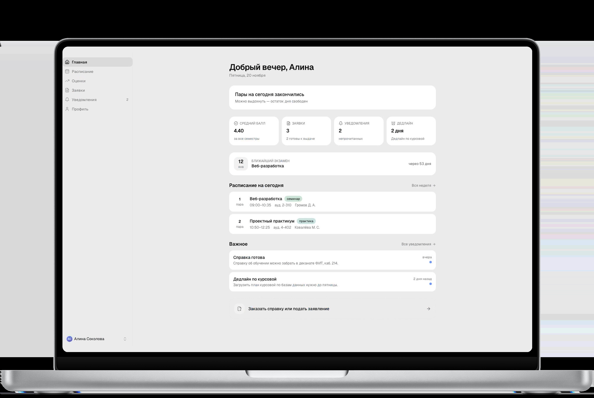
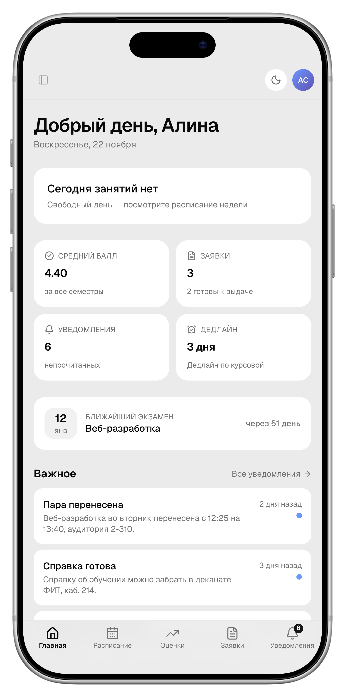

<div align="center">

# Цифровой деканат будущего

В личном кабинете студент смотрит расписание и оценки, заказывает справки и читает объявления.

[Открыть кабинет](https://dekanat.p0dyakov.workers.dev)
[Исходный код](https://github.com/p0dyakov/dekanat)

</div>



<div align="center">

</div>

## Как посмотреть

На [сайте кабинета](https://dekanat.p0dyakov.workers.dev) есть два тестовых аккаунта.

Для проверки войдите как `ivanova` (Алина Соколова, ИВТ-24-1) или `petrov` (Матвей Гордеев, ЭК-23-2). Пароль у обоих `dekanat2026`.

## Что есть в кабинете

- Главная: текущая и следующая пара, сводка успеваемости, заявок и дедлайнов
- Расписание: неделя по дням, переносы, отмены и замены с причинами
- Оценки: дисциплины семестра, средний балл, сессия с датами экзаменов
- Заявки: справка, заявление или вопрос деканату с историей статусов
- Уведомления: лента с фильтрами, непрочитанные помечаются точкой
- Профиль: данные студента и контакты деканата

## Как запустить локально

```bash
bun install
bun run dev
```

Нужен Bun. Откройте адрес, который напечатает [Portless](https://github.com/vercel-labs/portless). База `data/dekanat.db` создаётся и заполняется тестовыми данными при первом запросе.

Скриншоты для документации собираются скриптом `scripts/frame_screenshot.py`, для него нужен Pillow:

```bash
python3 scripts/frame_screenshot.py macbook raw.png out.png
python3 scripts/frame_screenshot.py iphone raw.png out.png
```

Скриншот должен быть непрозрачным и в точности повторять пропорции экрана: MacBook 3024×1964 (можно 1512×982), iPhone 1320×2868 (можно 440×956). Рамки устройств лежат в `video/public/frames`.

Запустите запись на работающем локальном сайте. Для записи нужен `screen-recorder`, для сборки [Remotion](https://www.remotion.dev/).

```bash
cd video
./scripts/record.sh
npm run render
```

По умолчанию сценарий записи открывает `http://dekanat.localhost/login`. Если [Portless](https://github.com/vercel-labs/portless) выдал другой адрес, скопируйте `recording.json`, поменяйте `url` и передайте путь через `SR_SCENARIO`.

`bun run build` собирает production-версию.

## Как устроены данные

- Стек: Next.js 16 (App Router, Server Actions), React 19, TypeScript, Tailwind CSS 4
- Локально SQLite через `node:sqlite`, на сайте Cloudflare D1 через OpenNext (`@opennextjs/cloudflare`)
- Пароли хранятся как scrypt-хеши с солью, сессия в httpOnly-cookie
- Запросы за учебными данными используют номер студента из сессии
- Расписание, оценки, заявки и уведомления для тестовых аккаунтов появляются при первом запуске

## Демонстрация

- [Как собирали прототип](docs/process.html): этапы, источники и решения
- [Обзор студенческих кабинетов](docs/RESEARCH.md) и [Примеры интерфейсов](docs/UI_RESEARCH.md)
- Видео `video/out/launch.mp4`, около 48 секунд: вход и проход по разделам в рамке ноутбука
- Скриншоты: [главная](docs/preview.png), [расписание](docs/preview-schedule.png), [новая заявка](docs/preview-request.png), [телефон](docs/preview-mobile.png)
